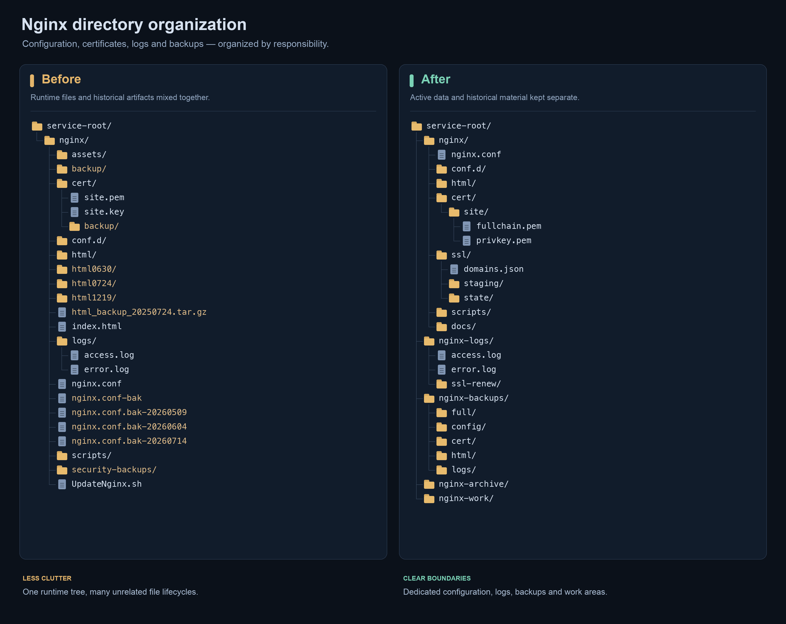

# nginx-ops-skill

[English](README.md) | [简体中文](README.zh-CN.md)

A reusable AI agent skill for inspecting and improving server Nginx deployments. It covers configuration layout, virtual host isolation, TLS certificate automation, log rotation, backups, and verified changes across native and Docker deployments.

The repository contains operating guidance, an optional read-only inspection helper, and a configurable Linux SSL automation script for an existing `acme.sh` installation. It does not install Nginx or provision servers.

## What it covers

- Discover the running service, actual configuration, mounts, scheduled jobs, and deployment sources.
- Separate public application roots, active files, backups, archives, and working directories.
- Plan changes around verified backups, candidate validation, graceful reloads, and before/after comparisons.
- Automate ACME staging, normal renewal and explicit reissue with checksummed certificate backups, atomic publication and recovery records.
- Design log rotation using Nginx log reopening, writer checks, compression verification, and an explicit retention policy.
- Preserve container bind mount identities and distinguish SPA fallbacks from unintended application exposure.

## Demo

From mixed runtime files and historical backups to separate configuration, certificates, logs, and recovery directories.



## Installation

Copy this directory into the skill directory supported by your agent. The agent must support `SKILL.md` with YAML frontmatter. Skill discovery and reload behavior depend on the host application; check its documentation.

Keep `SKILL.md`, `references/`, `scripts/`, and `examples/` together. For a user-level installation in a host that reads `~/.agents/skills/`, copy or link the repository as `~/.agents/skills/nginx-ops-skill`. Use your host's documented directory if it differs; do not overwrite an existing installation without checking it first.

## Usage

Example requests:

> Inspect the Nginx deployment on SSH alias `prod-web-2` in read-only mode and propose a directory cleanup plan.

> Plan TLS renewal and rollback checks without issuing a certificate or reloading the service.

> Review oversized access logs and the existing retention policy before proposing rotation changes.

The optional inspection script requires an explicit configured SSH alias:

```bash
bash scripts/inspect.sh --ssh prod-web-2
bash scripts/inspect.sh --ssh prod-web-2 --container nginx
```

The script uses Bash, OpenSSH, and basic remote system tools. Docker checks require Docker on the target host and access to the specified container. The script does not install missing tools.

## SSL automation

The [SSL automation guide](references/ssl-automation.md) covers the included manager, [configuration example](examples/ssl/certificates.example.json) and [cron example](examples/ssl/renew.cron).

```bash
# Read local state without issuing or publishing
python3 scripts/ssl_manage.py plan --config /etc/nginx-ops/certificates.json

# Normal scheduled coordination: publish an existing newer candidate, then renew if due
python3 scripts/ssl_manage.py reconcile --config /etc/nginx-ops/certificates.json

# Explicit early CA reissue for one group
python3 scripts/ssl_manage.py reissue --config /etc/nginx-ops/certificates.json --cert example.com
```

Configure paths, DNS plugin, trust and Nginx commands before using the write operations. The implementation targets Linux atomic directory exchange and RSA certificate groups. It keeps certificate candidates separate from live files, validates each pair, backs up the previous version and verifies origin TLS after a graceful reload. Timers use `reconcile`, not forced reissue.

## Repository layout

```text
SKILL.md                 Agent instructions and workflow
references/              Focused operating guidance
scripts/inspect.sh       Optional read-only inspection helper
scripts/ssl_manage.py    Configurable certificate automation
examples/ssl/            Example registry and renewal schedule
tests/                   Isolated SSL workflow tests
assets/                  Before-and-after directory diagram
evals/evals.json         Example evaluation cases
```

## Change boundaries

Read-only requests stay read-only. Issuance, backup creation, rotation, reloads, deployment, and cleanup are separate actions that require authorization within the task. Existing server conventions take precedence over example paths, timestamps, and retention values.

The workflow calls for backups and checks; it cannot guarantee zero downtime or automatic recovery on every deployment. A successful configuration check does not prove that all business routes work, and a reachable callback route does not prove a payment was processed.

## Validation

```bash
bash -n scripts/inspect.sh
python3 -m unittest discover -s tests -v
```

The evaluation cases describe expected agent behavior. They are examples, not an exhaustive benchmark or a claim of compatibility with every agent host.

## Contributing

See [CONTRIBUTING.md](CONTRIBUTING.md). Use fictional environments in examples and preserve the distinction between read-only inspection and authorized changes.

## License

[MIT](LICENSE).
