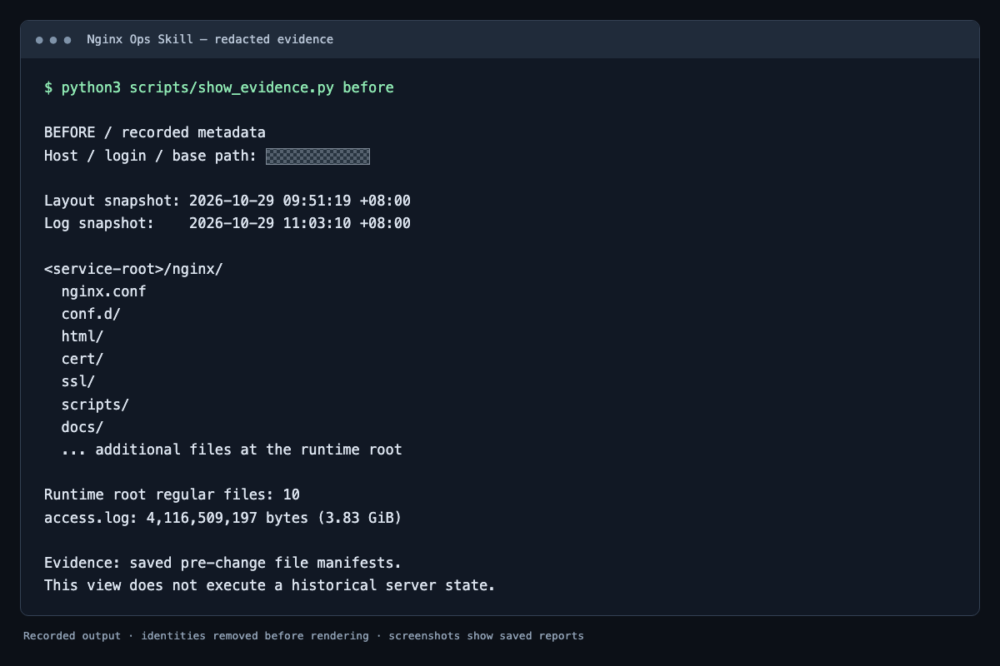
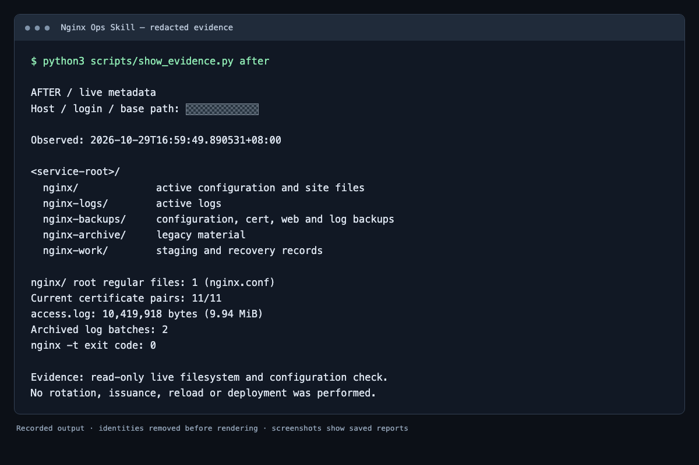

# nginx-ops-skill

[English](README.md) | [简体中文](README.zh-CN.md)

一个面向 AI 编程助手的服务器 Nginx 运维技能，覆盖配置整理、虚拟主机隔离、TLS 证书自动化、日志轮转、备份恢复和变更验证，适用于原生与 Docker 部署。

仓库提供操作方法和一个可选的只读检查脚本，不包含 Nginx 安装器、服务器创建流程，也不自带完整的生产证书管理器或部署平台。

## 覆盖范围

- 盘点真实运行服务、配置入口、挂载、定时任务和部署源。
- 区分应用公开根、在线文件、备份、历史归档和工作目录。
- 按校验备份、候选检查、平滑重载、前后对比的顺序实施变更。
- 检查 ACME 签发、候选与线上证书一致性、自动续期和回滚条件。
- 规划日志重开、旧文件写入检查、压缩校验和明确的保留策略。
- 保护容器挂载根目录，区分 SPA 首页兜底与真实跨站文件暴露。

## 清理前后展示

下面的终端样式截图使用一次服务器整理中的**真实脱敏数据**：清理前读取已保存的备份文件清单，清理后读取刚执行的只读检查结果。主机、登录身份、业务文件名和基础路径在渲染前移除，身份信息行另外做了可见遮挡。

这些是记录输出的浏览器渲染截图，**不是历史原生终端窗口截图**。展示只针对这次部署，不保证其他服务器获得同样结果；目录和日志快照的采集时间分别标在图中。

| 清理前 | 清理后 |
|---|---|
| 运行根目录有 10 个普通文件 | 根目录仅保留 `nginx.conf` |
| 活跃访问日志约 3.83 GiB | 截图采集时约 9.94 MiB，历史另行保留 |
| 在线资料混有待整理文件 | 在线文件、日志、备份、历史归档和工作区职责分开 |

### 清理前



### 清理后



活跃日志变小来自**轮转**，不代表删除历史或总存储占用减少。本次截图检查没有执行轮转、签发、重载或部署。详见[取证与脱敏说明](docs/demo-evidence.md)和[脱敏测量值](assets/evidence.json)。

## 安装

将本目录复制到所使用助手支持的技能目录。助手需要支持带 YAML 元信息的 `SKILL.md`；如何发现与重新加载技能，以对应工具的文档为准。

保持 `SKILL.md`、`references/` 和 `scripts/` 的相对位置不变。若宿主支持 `~/.agents/skills/`，可将本仓库复制或链接为 `~/.agents/skills/nginx-ops-skill`；其他宿主使用其文档规定的目录。覆盖已有安装前先检查内容。

## 使用

请求示例：

> 只读检查 SSH 别名 prod-web-2 上的 Nginx，给我一份目录整理方案。

> 检查 TLS 续期和回滚条件，不签发证书、不重载服务。

> 核对大日志和现有保留策略，再给出轮转方案。

可选检查脚本要求显式传入已有 SSH 别名：

```bash
bash scripts/inspect.sh --ssh prod-web-2
bash scripts/inspect.sh --ssh prod-web-2 --container nginx
```

脚本依赖 Bash、OpenSSH 和远端基础系统工具。容器检查需要远端安装 Docker，并有权访问指定容器。脚本不会自动安装缺失工具。

## 仓库结构

```text
SKILL.md                 技能入口与工作流程
references/              按主题组织的操作参考
scripts/inspect.sh       可选只读检查工具
scripts/show_evidence.py 显示已保存的脱敏演示报告
assets/                  脱敏报告和终端样式截图
docs/                    证据来源及补充说明
evals/evals.json         行为验证示例
```

## 变更边界

只读请求保持只读。签发、创建备份、轮转、重载、部署和清理属于不同操作，执行范围以用户当前授权为准。路径、日期和保留期示例不能覆盖服务器现有约定。

技能要求备份与验证，但不承诺所有部署都能零停机或自动恢复。配置检查成功不等于所有业务路由正常，回调地址可达也不等于支付已经完成。

## 隐私

公开版不包含生产环境档案、真实服务器地址、私有域名、个人本地路径、凭据、证书或历史对话。使用时在本地提供环境信息；不要将含敏感内容的检查输出和备份提交到仓库。

## 验证

```bash
bash -n scripts/inspect.sh
```

行为验证案例用于说明预期，不代表完整基准测试，也不意味着适配所有助手宿主。

## 参与贡献

参见 [CONTRIBUTING.md](CONTRIBUTING.md)。示例使用虚构环境，并保持只读检查与授权变更的边界清晰。

## 许可证

[MIT](LICENSE)。
